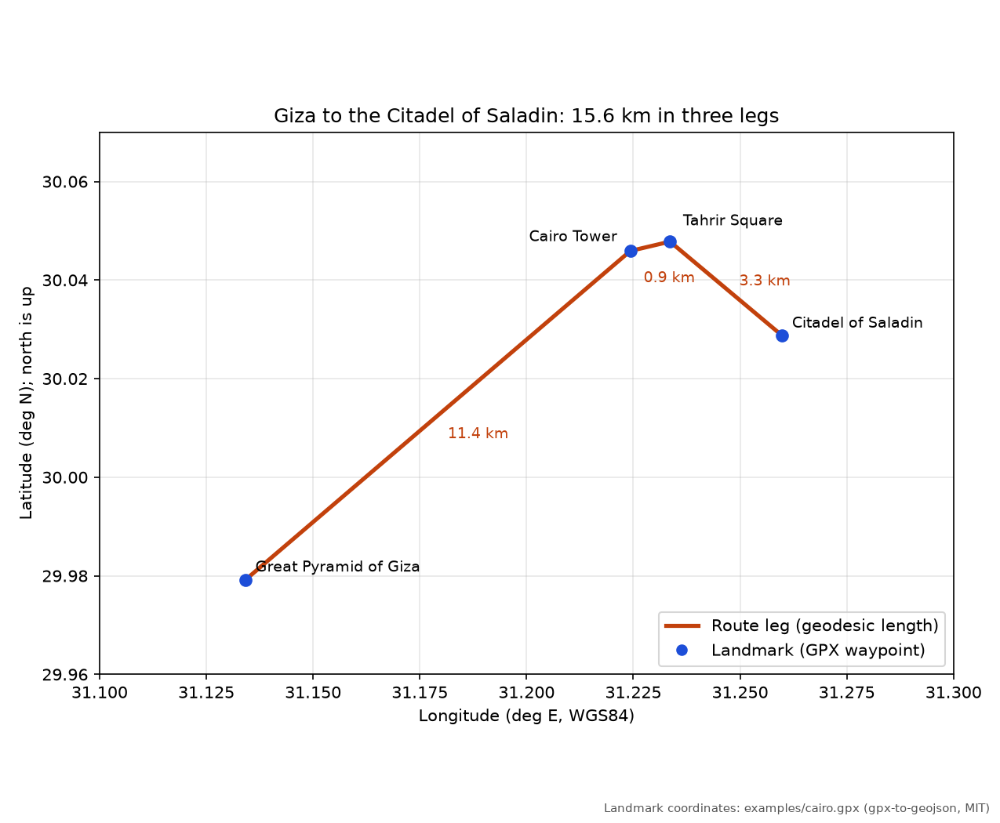

<p align="center">
  <picture>
    <source media="(prefers-color-scheme: dark)" srcset="assets/brand/logo-dark.svg">
    
  </picture>
</p>

# gpx-to-geojson

Convert GPX tracks, routes and waypoints to GeoJSON with timestamps, elevation and per-track distance and duration.

Part of [OpenTerra](https://github.com/AmmarYasser455), a family of open GIS tools.

[](https://colab.research.google.com/github/AmmarYasser455/gpx-to-geojson/blob/main/examples/demo.ipynb)
· [Demo map](https://ammaryasser455.github.io/gpx-to-geojson/)

GPX is what GPS devices and fitness apps export; GeoJSON is what web maps and GIS tools read.
This tool converts one to the other and adds the numbers people usually want next to a track:
geodesic length, start/end time, duration and elevation range. Lengths are computed on the
WGS84 ellipsoid with `pyproj.Geod` (not planar maths on degrees); geometries are built with `shapely`.

## Showcase

How long is a route from the Giza pyramids to the Citadel of Saladin, leg by leg?
[Report](showcase/README.md) · [web map](showcase/index.html) · [notebook](showcase/showcase.ipynb) · [GeoJSON](showcase/map.geojson)



## Install

```
pip install git+https://github.com/AmmarYasser455/gpx-to-geojson
```

Requires Python >= 3.10 (dependencies: `pyproj`, `shapely`).

## Command line

```
gpx-to-geojson examples/cairo.gpx -o cairo.geojson     # or: python -m gpx_to_geojson ...
gpx-to-geojson examples/cairo.gpx                      # prints GeoJSON to stdout
cat examples/cairo.gpx | gpx-to-geojson -              # reads GPX from stdin
```

Output for the route in `examples/cairo.gpx` (four real Cairo landmarks):

```json
{
  "type": "Feature",
  "properties": {
    "kind": "route",
    "name": "Giza to Citadel",
    "distance_m": 15637.09,
    "times": [null, null, null, null],
    "elevations": [null, null, null, null],
    "point_name": ["Great Pyramid of Giza", "Cairo Tower", "Tahrir Square", "Citadel of Saladin"]
  },
  "geometry": {
    "type": "LineString",
    "coordinates": [[31.1342, 29.9792], [31.2243, 30.0459], [31.2336, 30.0478], [31.2599, 30.0287]]
  }
}
```

(Arrays abbreviated onto one line here; the tool prints them one value per line. The example route
has no timestamps or elevations, hence the `null`s.)

## Python

```python
from gpx_to_geojson import convert, parse_gpx

fc = convert("examples/cairo.gpx")            # GeoJSON FeatureCollection as a dict
route = [f for f in fc["features"] if f["properties"]["kind"] == "route"][0]
print(route["properties"]["distance_m"])     # 15637.09

track = parse_gpx(gpx_xml_text)               # from a string
```

## Output

* Coordinates are always 2D `[lon, lat]` in WGS84 (RFC 7946 order). Elevation is never written as a third
  coordinate (RFC 7946 heights are ellipsoidal, GPX `<ele>` is usually above mean sea level); it is
  kept per vertex in the `elevations` property (waypoints: `ele`).
* `waypoint` -> `Point` with `name` (always, `null` if absent), `time` and `ele` (when present;
  elevation is not a coordinate) and every other standard GPX 1.1 waypoint field that is
  present: `cmt`, `desc`, `src`, `sym`, `type`, `fix`, `magvar`, `geoidheight`, `sat`, `hdop`,
  `vdop`, `pdop`, `ageofdgpsdata`, `dgpsid` and `links` (list of `{href, text, type}`). Waypoints
  carry no distance or duration. `route` -> `LineString`;
  `track` -> `LineString` (one segment) or `MultiLineString`.
* Route and track properties: `distance_m` (geodesic, metres; the gap between track segments is not
  counted), `start_time` and `end_time` (when at least one timestamp exists), `duration_s` (needs at
  least two valid timestamps), `elevation_min_m`, `elevation_max_m` (when any elevation exists),
  and the per-vertex arrays `times` (UTC ISO 8601) and `elevations` (metres), with `null` where a
  vertex has no value. For a multi-segment track these arrays are nested, one list per segment.
  Tracks also carry `segments`.
* Routes and tracks keep their own standard fields (`name`, `cmt`, `desc`, `src`, `number`,
  `type`, `links`). Standard fields of route/track points (e.g. the landmark names of the example
  route) are kept as per-vertex arrays named `point_<field>` (`point_name`, `point_desc`, ...),
  added only when at least one vertex has that field, with `null` elsewhere and nested per segment
  like `times`.
* The GPX `<metadata>` `name`, `desc`, `keywords`, `time` and links are kept as a top-level
  `metadata` member of the FeatureCollection.

A walkthrough is in [examples/demo.ipynb](examples/demo.ipynb) (its first cell installs the package
and downloads the example GPX when run in a fresh runtime such as Colab); the demo map is built from
`docs/demo.geojson`. Example data sources are described in [examples/README.md](examples/README.md).

## Limitations

* The bundled example has no timestamps or elevations (it is a route between landmarks); those
  features are covered by synthetic GPX in the tests.
* Only GPX `wpt`, `rte`, `trk` and part of `metadata` are handled; `<extensions>` (heart rate,
  etc.), metadata author/copyright/bounds and the GPX `creator` are not converted.
* Numeric GPX fields (`sat`, `hdop`, `number`, ...) that are not valid finite numbers are dropped.
  Integer fields (`sat`, `dgpsid`, `number`) must be plain non-negative ASCII integers of at most
  15 digits (so they stay exact in JSON); larger or malformed values are dropped.
* Timestamps that fall outside years 1–9999 once converted to UTC are treated as missing.
* Points with invalid coordinates, lines with fewer than two valid points and collapsed lines (all positions identical) are silently skipped.
* Non-finite (NaN/infinity) elevations are treated as missing.
* Routes and track segments crossing the antimeridian are rejected with a `ValueError` rather than split.
* Unparseable timestamps are treated as missing; timestamps without a zone are taken as UTC.
* Elevation is reported as recorded, in properties only (no geoid correction or smoothing) and distance is 2D (elevation is not included).
* No simplification or GPS-noise filtering; stopped time is included in `duration_s`.
* GPX files that declare XML entities (`<!ENTITY ...>`) are rejected with a `ValueError`, to rule out
  entity-expansion attacks; real GPX never uses them.
* Input is XML in the encoding named by its declaration (UTF-8 by default). `parse_gpx` accepts only
  non-empty `str`/`bytes` and `convert` only `str`/`os.PathLike` paths; other types raise `TypeError`.

## License

MIT, see [LICENSE](LICENSE).
