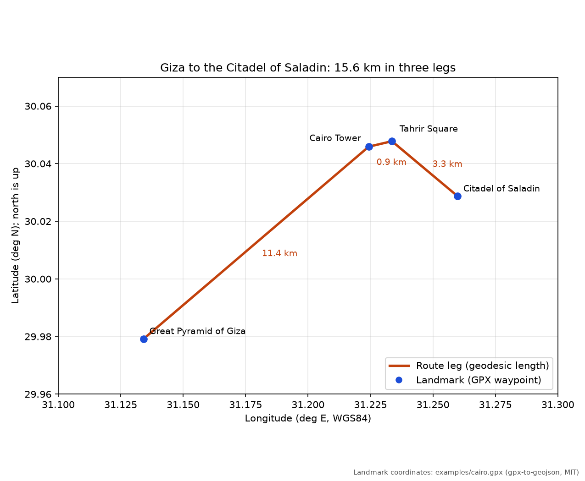

# Giza to the Citadel: gpx-to-geojson on real Cairo coordinates

## Question

How long is a route from the Great Pyramid of Giza to the Citadel of Saladin via Cairo Tower and Tahrir Square, and how is that length split over its legs?

## Data

* File: `data/cairo.gpx` (about 1 KB), a copy of [`examples/cairo.gpx`](../examples/cairo.gpx) in this repository.
* Source: four landmark coordinates (lat/lon, WGS84) entered by hand for this repository's examples; it is not a recorded GPS track and has no timestamps or elevations. Source URL: https://github.com/AmmarYasser455/gpx-to-geojson/blob/main/examples/cairo.gpx
* License: MIT (this repository, see [LICENSE](../LICENSE)). Map tiles in the web map are (c) OpenStreetMap contributors (ODbL).
* Date fetched: 2026-11-18 (copied from the repository, no download).

## Method

* `gpx_to_geojson.convert("showcase/data/cairo.gpx")` returns a GeoJSON FeatureCollection with four waypoints and one route. Coordinates are `[lon, lat]` in EPSG:4326 (RFC 7946).
* The route length `distance_m` is geodesic on the WGS84 ellipsoid (`pyproj.Geod`), in metres.
* `make_showcase.py` adds one `leg` feature per pair of consecutive route points, with `distance_m` from `pyproj.Geod.inv` (WGS84, metres) and the names of its end points.
* The static map plots lon/lat degrees with the aspect ratio set to 1/cos(30.03 deg) so shapes are not stretched east-west.

## Results

* The route is 15,637.09 m (15.6 km) long.
* Leg 1, Great Pyramid of Giza to Cairo Tower: 11,411.65 m.
* Leg 2, Cairo Tower to Tahrir Square: 921.30 m.
* Leg 3, Tahrir Square to Citadel of Saladin: 3,304.14 m.
* The first leg is about 73% of the route. These are straight lines between landmarks, so they are shorter than any road distance.



* Web map: [index.html](index.html) (Leaflet, needs internet for tiles and the Leaflet files; serve the folder, e.g. `python -m http.server`, because it fetches `map.geojson`)
* Notebook: [showcase.ipynb](showcase.ipynb)
* GeoJSON: [map.geojson](map.geojson)

## Rebuild

```
python showcase/make_showcase.py
```

Runs offline from `showcase/data/` and rewrites `map.geojson`, `map.png` and `index.html` (the PNG needs matplotlib). `tests/test_showcase.py` checks that the committed `map.geojson` matches a fresh build.
The notebook is executed with `python -m jupyter nbconvert --to notebook --execute --inplace showcase/showcase.ipynb` (or nbclient).

## Limitations

Straight lines between four landmarks, not a road network or a recorded track; no time or elevation results.
